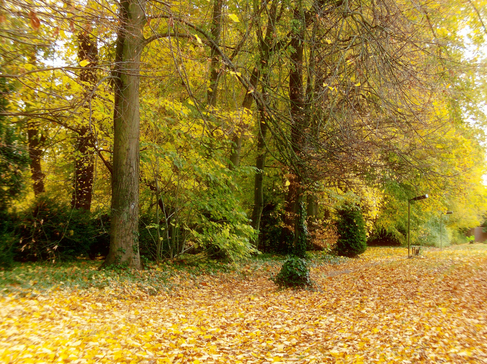
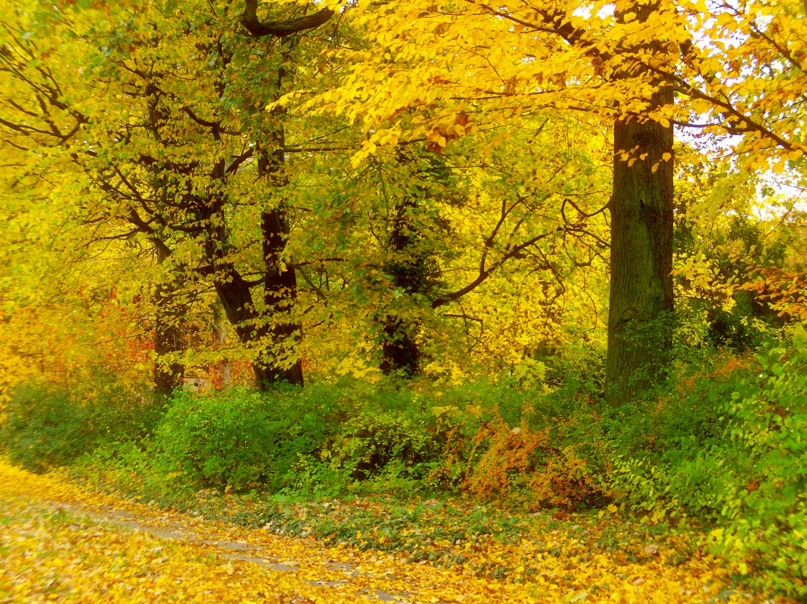
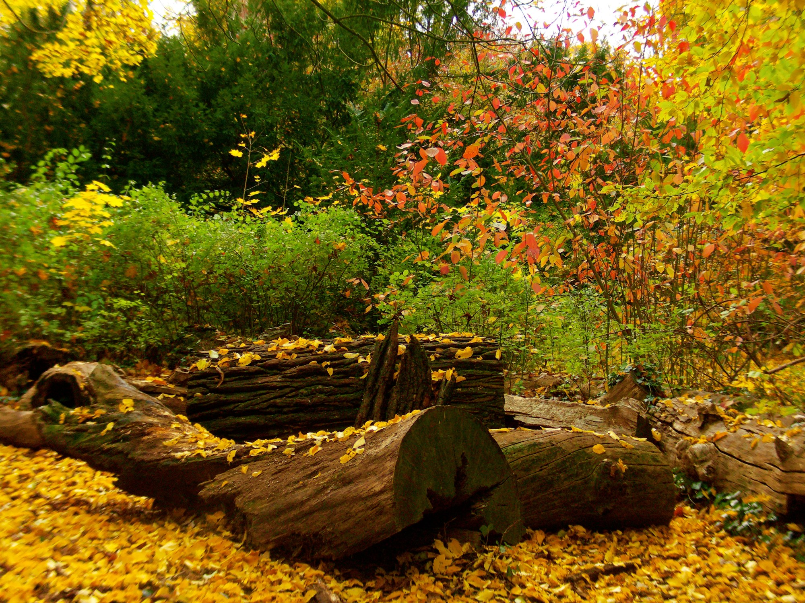
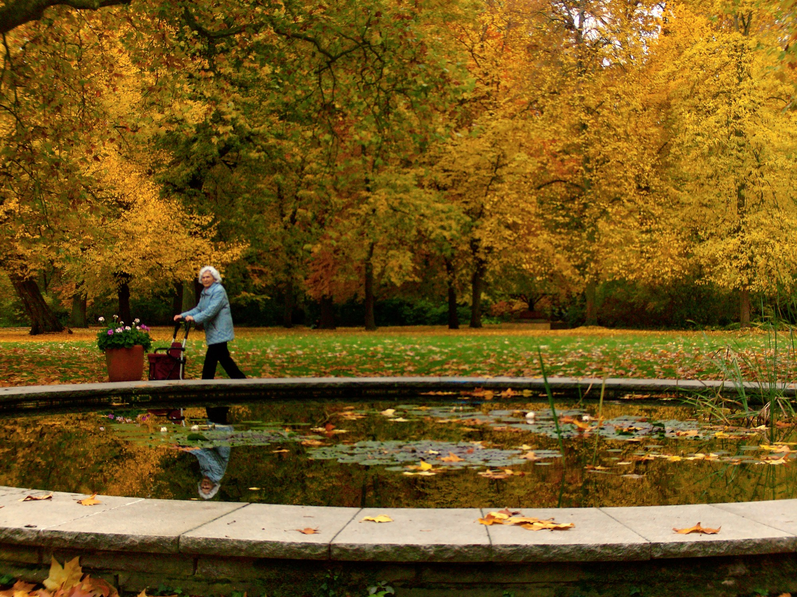
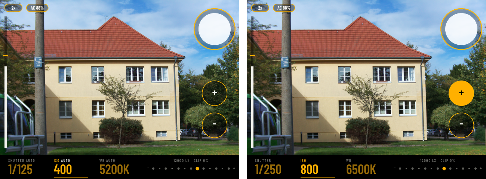

# Introduction
This entire idea took shape from trying to find a kid friendly camera for my son, which escalated into a full blown project consisting of Raspberry Pi 4 portable camera with IMX477 sensor and C mount lens, 3D LUT grading via machine learning using some hand selected sources and 3d printed case.

The prototype phase is still in progress, the repo is super messy hence I'm experimenting with various hardware, software, and photo grading techniques.


# Pi Film Reversal

A Raspberry Pi camera that recreates film and photographic looks.

- It learns a colour grade (a 3D LUT) from a set of reference photographs, on a Mac.
- It applies that grade on the Pi, at the moment you take the photo.
- It saves the original and the graded photo side by side.

The bundled look is a **handcrafted, untrained starter preset**. No reference photographs were used to make it.

Trained looks and training data are not in the repo. To grade with a trained look, name it:

```bash
pifilm-process /path/to/ungraded-photos /path/to/results \
  --artifacts artifacts/personal-collection-01-v1
```

Without `--artifacts`, every command uses the starter preset.

## Sample results

### Latest LUT: Agfachrome

Photos captured and graded on the Raspberry Pi with the HQ Camera (IMX477) and the latest look,
`agfachrome-2026-10-d-dark`, a slide-film look after Agfachrome 50S
([training report](docs/training-agfachrome-2026-10.md)). The first two have halation on, the
last two have it off:
<p>
  
  
  
  
</p>

### Earlier looks

Photos captured and graded on the Raspberry Pi with the Camera Module 3 Wide (IMX708):
<p>
  
  
  
  
  
  
</p>

## Current build


## 3D printed body


The first prototype case, above, has been replaced by a new design: the **πTone 500**.

- A waist-level box camera, in the style of a Hasselblad or Rolleiflex.
- It replaces the X728-C1 metal case.
- The HQ camera sits in the lens board. The 3.5" screen sits under a fold-up hood.
- The STLs are ready to print. Nothing has been printed yet.

STLs, renders and the build guide: [camera-body/README.md](camera-body/README.md).

## Hardware
- Raspberry Pi 4, 4GB RAM
- Raspberry Pi HQ Camera, IMX477 sensor (current)
- Arducam 8-50mm C-Mount Zoom Lens for IMX477
- Raspberry Pi Camera Module 3, Wide, IMX708 sensor (earlier)
- Waveshare 3.5 inch DSI LCD (E) touchscreen: the viewfinder
- A momentary push button on two jumper wires: the physical shutter, GPIO 21
- Geekworm X728 UPS shield + X728-C1 metal case
- 4x 18650 Li-ion cells, about 10000mAh
- 64GB SD card

## The display



The 3.5 inch touchscreen is the viewfinder. Left: everything on auto. Right: full manual.

- **Live view**: full screen, about 10 frames per second.
- **Shutter button**: the big ring, top right. Tap it to take a photo.
- **SHUTTER, ISO, WB**: tap one to select it. Then `+` and `−` change it.
- **Auto or manual**: each of the three can be `AUTO` or a fixed value. Fix all three for full manual.
- **Exposure meter**: the row of dots. The lit dot shows if the photo will be too dark or too bright.
- **Focus gauge**: the bar on the left. Higher means sharper.
- **2x**: double exposure. Two shots become one photo.
- **MENU**: opens the settings menu (see below).
- **Battery**: charge level, top left.
- **Light and clipping**: lux, and how much of the picture is blown out.
- **After a shot**: colour bars while the Pi works, then a quick preview. Tap to go back.
- **Developing**: an amber number next to the battery. It counts photos still being graded. Wait for it to go before you switch off.
- **Sleep**: the screen turns off after 5 minutes. A tap wakes it.

Amber warning tags:

- **TUNING**: the camera's tuning file is not the one the look was trained with. Photos are still taken.
- **PHOTOS NN%** / **SD NN%**: the photo folder or the SD card is 90% full or more.
- **IMG**: sharpness, contrast or saturation is not at normal.
- **STAB**: a stabilise setting is on.

More in [the viewfinder guide](docs/lcd-viewfinder.md).

### Settings menu

Tap `MENU` in the bottom strip. Tap a row to change it. `DONE` closes the menu.

- **CAMERA**
  - **IMAGE**: sharpness, contrast, saturation (0.5 to 1.5).
  - **AE CONSTRAINT**, **AE METERING**: how auto exposure works.
- **PIPELINE**
  - **SAVE DNG**: save the raw file, or not.
  - **HALATION**: the look's glow on or off.
  - **STABILISE**: short exposure, shutter delay (0.2 s or 0.5 s), multi-frame (2, 4 or 6 frames).
- **NETWORK**: the Pi's Ethernet and Wi-Fi addresses. **UPLOAD** starts a Nextcloud sync.
- **LOOK**: the name of the look in use.
- **RESET**: tap twice to put every setting back.

Settings are saved and kept after a restart.
Full table: [Settings menu](docs/lcd-viewfinder.md#settings-menu).

## From shutter button to saved photo

```text
Press the button (GPIO 21), or tap the screen
    ↓ optional shutter delay (0.2 s or 0.5 s), so the camera stops shaking
The Pi takes one photo at a time. A press during a photo is ignored.
    ↓ colour bars on the screen
Camera switches to full resolution → takes one frame (or a burst) → back to live view
    ↓
Save: original JPEG (+ raw DNG, if SAVE DNG is on)
    ↓
The screen shows a quick preview. The camera is ready for the next photo.
    ↓ in the background, up to three photos waiting
Multi-frame only: line up the frames and merge them into one
    ↓
Grade: normalize → halation → 3D LUT → grain
    ↓ on the Pi's graphics chip: about 0.6 s, about 1 s with halation
Save: graded JPEG + one line in captures.jsonl
```

If the power goes before a photo is graded, the Pi finishes it at the next start.

The grading has four steps, always in this order:

- **Normalize**: fixes exposure and levels, so every photo starts from the same place.
- **Halation**: a soft red-orange glow around bright light, like colour film. Only when the look turns it on.
- **3D LUT**: the look. A colour table that maps every colour to a new one.
- **Grain**: film-like noise, added last. A simple grain, or one measured from Ilford HP5 scans.

More: [how it works](docs/how-it-works.md#at-capture-time-on-the-pi).

### Graphics chip (GPU)

- The Pi grades on its graphics chip when it can. It is about 2.5 to 3 times faster.
- It tests the chip at every start. If the test fails, it grades on the processor.
- The chip needs the HP5 tile grain, or no grain. The starter preset uses the simple grain, so it grades on the processor.
- A GPU photo matches the processor's within a few levels. Not byte for byte.
- Check it on the Pi: `pifilm-gpu-check --artifacts DIR`.

More: [Grading on the GPU](docs/how-it-works.md#grading-on-the-gpu).

### Double exposure and multi-frame

- **Double exposure** (`2x` on screen): two shots are added together, then graded once. [More](docs/how-it-works.md#double-exposure).
- **Multi-frame** (menu, STABILISE): a burst of 2, 4 or 6 frames. Each frame gets a shorter exposure. The frames are lined up and averaged into one photo. Less noise and less shake. Moving things are kept from one frame only, so there are no ghosts. [More](docs/how-it-works.md#multi-frame-photographs).

### Tuning check

- A look is trained under one camera tuning file.
- At start the Pi compares the camera's tuning with the look's.
- If they differ, the screen shows `TUNING`. It only warns.
- `pifilm-tuning --stamp DIR` writes the tuning into a look.

More: [The tuning check](docs/how-it-works.md#the-tuning-check).

## Running modes

The Pi captures, grades and stores.

- Ethernet and SSH are for admin and photo transfer.
- In the field the Pi runs its own Wi-Fi hotspot, so a phone or laptop can still SSH in.

| Mode | Command | Notes |
| --- | --- | --- |
| Camera with screen and button | `pifilm-capture --no-preview --display waveshare35dsi --shutter-gpio 21` | the touchscreen is the viewfinder; the button and the on-screen shutter take the same kind of shot |
| Headless with button | `pifilm-capture --no-preview --shutter-gpio 21` | no screen; each press takes a photo |
| Two-screen | `pifilm-capture --show-captures` | run in a Pi desktop session; shows colour bars, then the photo |

The service runs the first mode. With no screen attached, it falls back to the second.
Config and rollback: the [network & service guide](docs/pi-service.md).

## Getting started

Full walkthrough: **[the setup guide](docs/setup.md)**. It is ordered by dependency and names the machine for every step.

1. Set up the Mac (Python venv, tests).
2. Write the `.env` file.
3. Set up the Pi: OS, Ethernet, hotspot.
4. Install the capture service. Optional: UPS, screen, button, Nextcloud.
5. Optional: train a look.

Other Pi guides:

- [Network & service](docs/pi-service.md): Ethernet, hotspot, systemd service, rollback.
- [LCD viewfinder](docs/lcd-viewfinder.md): wiring, setup, screen, menu, checklist.
- [X728 UPS](docs/x728-ups.md): battery level, safe shutdown, real-time clock.
- [Photo volume](docs/photo-volume.md): a fixed-size space for photos, so they cannot fill the SD card.
- [Picamera2 bring-up](docs/picamera2-bringup.md): first checks for a new Pi camera.
- [Known issues](docs/known-issues.md): includes `scripts/pi_journal.py`, which keeps the logs across reboots.

## Using the tools directly

Commands:

| Command | What it does |
| --- | --- |
| `pifilm-capture` | take photos on the Pi |
| `pifilm-process IN OUT` | re-grade a folder of photos |
| `pifilm-battery` | print the X728 battery level (Pi only) |
| `pifilm-gpu-check` | grade on the GPU and compare with the reference (Pi only) |
| `pifilm-tuning` | print the camera tuning's fingerprint; stamp it into a look |
| `pifilm-train` | train a look (Mac) |
| `pifilm-preset` | rebuild the starter preset |
| `pifilm-fetch` | download a Wikimedia Commons category as a corpus |

`pifilm-process` and its log:

- It reads the folder's `captures.jsonl`, if there is one.
- It uses the same grain seed and settings the Pi used, so it rebuilds the Pi's graded photo.
- Exact for a USB camera. Very close for the Pi camera, and for photos graded on the GPU.
- It merges multi-frame shots again, from their saved frames.

Capture flags:

| Flag | Behaviour |
| --- | --- |
| `--show-captures` | fullscreen window; `SPACE` takes a shot (colour bars while it works) and shows it until the next; `Q`/Esc quits |
| `--no-preview` | terminal controls, no window |
| `--fake` | synthetic frames, no camera (for testing) |
| `--device /dev/videoN` | select a specific USB camera |
| `--display waveshare35dsi` | LCD viewfinder; `waveshare28` for the older 2.8" SPI panel ([guide](docs/lcd-viewfinder.md)) |
| `--display-rotate 180` | turn the screen upside down |
| `--shutter-gpio 21` | physical shutter button between BCM 21 and ground ([setup](docs/setup.md#48-optional-shutter-button)) |
| `--ups x728` | read the X728 battery and show it on the screen ([guide](docs/x728-ups.md)) |
| `--grade background` | default: free the camera at once and grade behind it; `inline` grades first |
| `--grade-backend auto` | default: use the GPU when it can; `cpu` never does |
| `--disk-warn-percent N` | warn when the disk is N% full (default 90) |
| `--nextcloud-env PATH` | turns on the menu's UPLOAD row |

Output lands in `~/Pictures/pifilm/YYYY-MM-DD/`:

- `*_original.jpg` (or `*_ungraded.jpg` from a USB camera that cannot give its own JPEG)
- `*.dng`, the raw file, if SAVE DNG is on (about 18 MB)
- `*_frame2.jpg` and on, the extra frames of a multi-frame shot
- `*_graded.jpg` (or `*_double_graded.jpg`)
- `captures.jsonl`: one line per photo, with everything needed to grade it again

### Camera backends

`--camera` picks the backend.

- With `--device`, it is `v4l2` (a USB camera).
- Otherwise it is Picamera2 when it imports, else V4L2.
- Picamera2 and libcamera come from Raspberry Pi OS apt, never pip. The venv uses `--system-site-packages`.

| Command | What it captures |
| --- | --- |
| `pifilm-capture --camera v4l2 --device /dev/video0` | USB (UVC) camera at 1920×1080 |
| `pifilm-capture --camera picamera2` | Pi camera at the sensor's full size (IMX477: 4056×3040, IMX708: 4608×2592) |

- libcamera picks the tuning file for the sensor. `--tuning-file imx477.json` pins it.
- The Pi in use runs `--tuning-file imx477.json`.
- First-time checks for a new camera: [the Picamera2 bring-up checklist](docs/picamera2-bringup.md).
- The starter preset assumes the Pi camera's own white balance. For a USB camera, use a copy of the look with `"white_balance": true` in its `params.json` ([how it works](docs/how-it-works.md#at-capture-time-on-the-pi)).

Picamera2 flags:

| Flag | Action |
| --- | --- |
| `--autofocus {continuous,auto,manual}` | autofocus mode (default `continuous`) |
| `--af-range {normal,macro,full}` | autofocus range (default `normal`) |
| `--no-dng` | do not save the raw file |
| `--ae-lock` / `--awb-lock` / `--colour-gains R,B` | lock exposure / white balance for controlled shoots |
| `--ae-constraint {normal,highlight,shadows}` | AE constraint (default `normal`); `highlight` protects bright areas |
| `--ae-metering {centre,spot,matrix}` | AE metering (default `centre`) |
| `--white-balance K` | start with a fixed white balance in kelvin (default: auto) |
| `--tuning-file NAME` | pin the libcamera tuning file |

A value saved in the settings menu wins over the flag.

### The starter preset

- More midtone colour and contrast, with a smooth tone curve.
- Out-of-gamut colours are pulled back.
- A light, simple grain (`0.004`).

Rebuild it:

```bash
.venv/bin/pifilm-preset --out artifacts/starter-v1
```

`--highlights 0.6` holds bright colours back from clipping. `0` (the default) is the current look.

## Archiving photos to Nextcloud

Optional backup. The Pi copies `~/Pictures/pifilm` to a Nextcloud folder with `rclone copy`.

- **Copy, never delete**: cleaning the SD card never removes the cloud copies.
- **Home network only**: a run stops at once when Nextcloud cannot be reached, for example on the hotspot.
- **Incremental**: files already uploaded are skipped.
- **Every 15 minutes**, by a systemd timer.
- **From the screen**: the menu's UPLOAD row starts a sync and shows its status.

Setup, on the Pi:

```bash
sudo apt install rclone                                # one-time
# then fill NEXTCLOUD_* in .env (a Nextcloud app password, not your login)

.venv/bin/python -m pifilm.nextcloud --env .env          # dry run (no transfer)
.venv/bin/python -m pifilm.nextcloud --env .env --apply  # real copy

# enable the 15-minute timer
sudo cp deploy/pifilm-nextcloud-sync.service.example /etc/systemd/system/pifilm-nextcloud-sync.service
sudo cp deploy/pifilm-nextcloud-sync.timer.example   /etc/systemd/system/pifilm-nextcloud-sync.timer
sudo systemctl daemon-reload
sudo systemctl enable --now pifilm-nextcloud-sync.timer
systemctl list-timers pifilm-nextcloud-sync.timer      # confirm NEXT / LAST
```

Full guide: [docs/nextcloud-sync.md](docs/nextcloud-sync.md).

## Training a look

Training is optional. The camera works with the starter preset.

- Give `pifilm-train` two folders: your camera's photos, and reference photos you have the rights to use.
- It fits a 33³ `.cube` LUT.
- It tests the LUT on photos it did not train on, and checks it with quality gates.
- It writes a report. Exit code 3 means a gate failed.
- A LUT only changes global colour and tone.

After training, two scripts change a look without training again:

- `scripts/stamp_halation.py`: turn halation on or off, and set its strength.
- `pifilm-tuning --stamp`: record the tuning file the look was trained with.

Guide: [the training guide](docs/training.md). Short version: [setup §5](docs/setup.md#5-training-a-look-optional).

## How the colour model works

The "model" is a **33 × 33 × 33 colour lookup table** (a standard `.cube`), not a neural network.

- It is fitted with classical colour statistics. There is no ML runtime on the Pi.
- **A look** is the LUT plus its settings for normalize, halation and grain.
- **At capture**: normalize → halation → 3D LUT → grain. Code: `pifilm/pipeline.py`.
- **At training**: sample both sets of photos, match their colours, fit the LUT, then check five gates.
- The starter's normalize settings were tuned on the IMX708 ([write-up](docs/experiments/2026-09-19-imx708-normalisation.md)).

Full detail (the maths, the libraries, what a LUT cannot do): **[docs/how-it-works.md](docs/how-it-works.md)**.

Experiment write-ups: [docs/experiments/](docs/experiments/).

## Known issues

Understood but unfixed problems: [docs/known-issues.md](docs/known-issues.md).

See [ORIGIN.md](ORIGIN.md) for the code's starting point and what is independent.
