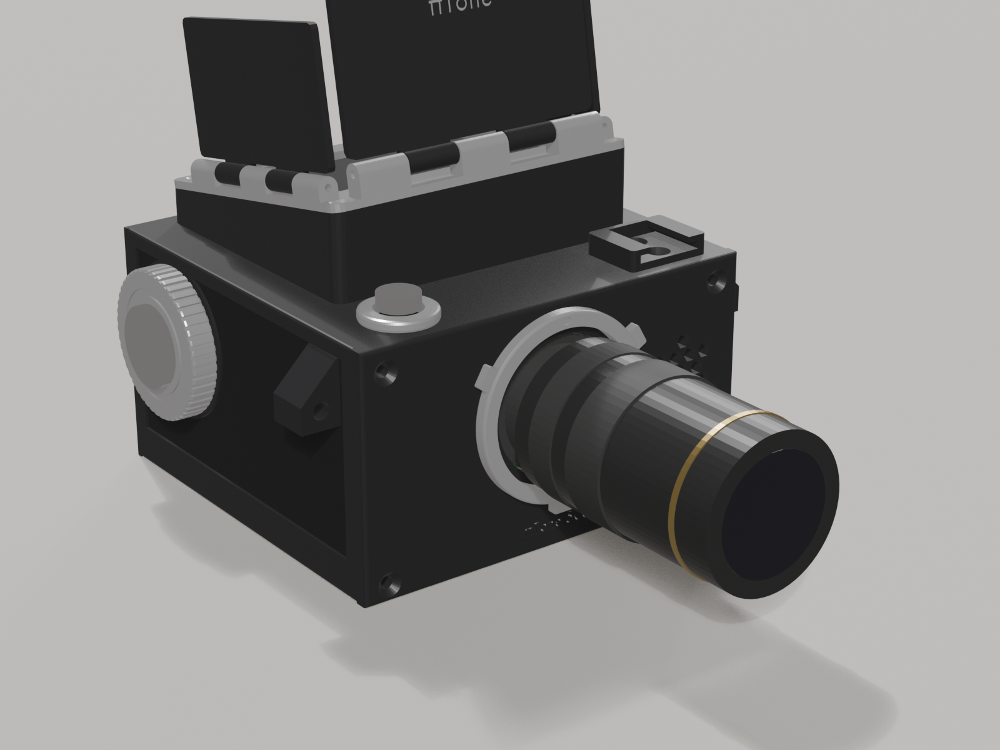
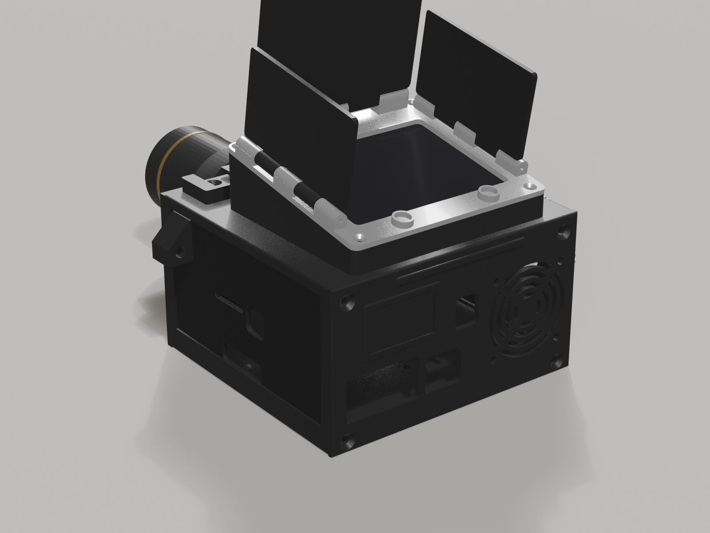
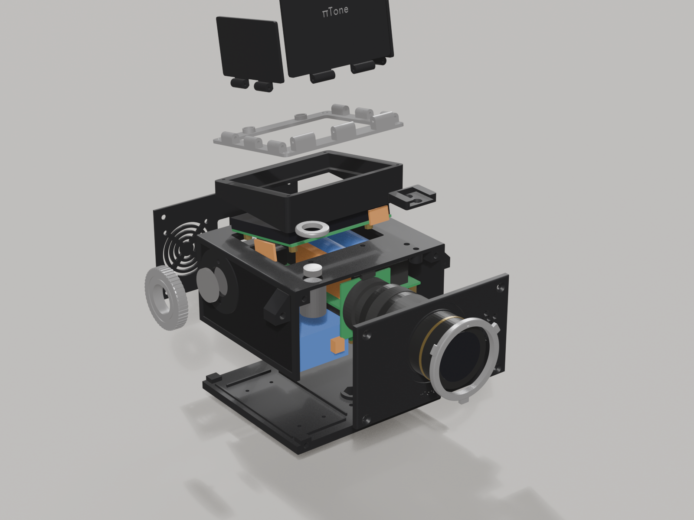

# πTone 500 (PiTone) — retro body for the Pi film-simulation camera

A 3D-printable, Hasselblad/Rolleiflex-style **waist-level box camera body** that replaces the
Geekworm X728-C1 metal case. The Pi 4, X728 UPS (+ its cells), the extra 2× 18650 holder, the
4010 fan and the 19 mm power button go in unmodified; the Raspberry Pi HQ camera is built
into the lens board, and the Waveshare 3.5" DSI screen sits under a fold-up hood like a waist-level finder.



| | |
|---|---|
|  |  |

Body ≈ 115 W × 112 D × 65 H mm. The finder on top tilts the screen 10° toward you
(Hasselblad-style viewing angle); with the hood folded the camera is ≈ 98 mm tall.

**Holding it:** shutter button under your right index finger, power knob on the right side
wall, cold shoe front-left, left hand free for the lens. The micro-HDMI / charging / LED
openings are on the left side wall, USB + Ethernet + DC jack + fan on the back. (File names
like `coupon_right_wall` and `hood_flap_l` use Blender's front view, i.e. mirrored from yours.)

## What's in this folder

```
stl/      print-ready STLs, already in print orientation
renders/  preview renders
```

The parametric Blender build (every dimension in one params file), the component-dimension reference
and the full pre-print checklist live in the design workspace and aren't published here.

## Status — what is and isn't verified

Verified in the model:
- No part intersects any component proxy (Pi ports, X728 + cells, dupont wires, extra holder,
  fan, switch, shutter button, camera, DSI screen + its standoffs, flex and FFC). The check was validated by forcing
  deliberate collisions and confirming they are caught.
- Every part is a closed mesh; every STL is independently checked to be watertight and to sit at Z = 0.

**Not** verified: nothing has been printed yet. Component positions come from manufacturer drawings
and tape/ruler photos of the real parts (2026-11-12), so expect ±1 mm. Print the two coupons first.

## Before printing

Check the parts you have against the model: the Waveshare 3.5" DSI LCD (E), the X728 V2.x + cells, the
extra 2 × 18650 holder (its floor-hole pattern, 57 × 19 mm, is read off a photo), your heat-set
inserts and magnets. Then print the two
coupons (≈10 min each) and hold them against the stack sitting on its 5 mm standoffs:
- `coupon_right_wall.stl` — micro-HDMI slot, X728 USB-C, LED window (the port wall)
- `coupon_film_back.stl` — USB ×4, Ethernet, DC jack

## Print guide

Settings: 0.2 mm layers, 4 perimeters, 5 top/bottom layers, 20–25 % gyroid. STLs are already
oriented for printing.

Why PETG: PLA softens at ~55–60 °C, which is too close to a Pi 4 and charging 18650s in a closed
box. Everything that forms the body or sits on it is PETG; only the small outside trim (ring,
knob, shutter collar) is silk PLA, for its chrome-like sheen.

| STL | Material | Colour | Est. filament | Supports | Notes |
|---|---|---|---|---|---|
| `sleeve` | PETG | black | 64 g | none | prints upside down (deck on bed); 136 × 106 mm footprint |
| `base_plate` | PETG | black | 61 g | none | |
| `lens_board` | PETG | black | 29 g | none | front face down; fill the debossed nameplate with a silver paint pen |
| `film_back` | PETG | black | 19 g | none | memo panel takes a small label (e.g. the active LUT name) |
| `hood_lid` | PETG | black | 15 g | none | |
| `hood_flap_l`, `hood_flap_r` | PETG | black | 7 g each | none | |
| `cold_shoe` | PETG | black | 2 g | none | |
| `finder_base` | PETG | black | 34 g | none | 10° wedge that holds the screen; prints on its flat bottom |
| `finder_bezel` | PETG | silver | 13 g | none | prints flat; sits on the warm finder, hence PETG |
| `bayonet_ring` | silk PLA | silver | 3 g | none | glue into the lens-board groove; paint the index dot red |
| `power_knob` | silk PLA | silver | 7 g | none | face down |
| `shutter_collar` | silk PLA | silver | 1 g | none | |
| `coupon_right_wall`, `coupon_film_back` | PETG | any | 4 g + 6 g | none | fit tests, print first |

### Filament shopping list

| Filament (1.75 mm) | Parts | Est. amount |
|---|---|---|
| **Black PETG** | sleeve, base plate, lens board, film back, finder base, hood ×3, cold shoe | ≈ 235 g (+ ≈ 10 g for the test strips) |
| **Silver PETG** | finder bezel | ≈ 13 g |
| **Silver silk PLA** | bayonet ring, power knob, shutter collar | ≈ 11 g |

Estimates come from the model's volumes and surface areas with the settings above; expect your
slicer to land within about ±20 %. A 1 kg black spool covers the body several times over (handy
for reprints after caliper corrections); the silver amounts fit a 250 g or sample spool.
To keep it to two spools, print all four silver parts in silver PETG (≈ +1 g); you lose a little
of the chrome sheen.

## Hardware

| Qty | Item | Where |
|---|---|---|
| 10 | M3 heat-set insert, Ø4.0 hole × 6 (e.g. M3 × 5.7) | 4 sleeve corners, 4 base corners, 2 cold shoe (buy a few spare) |
| 8 | M3 × 8 countersunk | lens board + film back |
| 2 | M3 × 6 countersunk | cold shoe |
| 4 | M3 × 6 countersunk (self-tapping into Ø2.6) | extra 18650 holder onto the base plate, from inside the holder |
| 4 | M3 × 8 pan head (self-tapping into Ø2.6) | finder base onto the deck, from inside the body |
| 4 | M2.5 × 6 countersunk (self-tapping into Ø2.2) | finder bezel onto the finder base |
| 4 | M2.5 heat-set insert, Ø3.6 hole | base plate, takes the existing M2.5 × 5 + 5 Pi standoffs |
| 4 | M2.5 × 6 self-tapping or machine screw | HQ camera onto lens-board pillars (Ø2.2 pilots) |
| 4 | M3 × 16 + nut (or self-tapping fan screws) | fan onto film back |
| 1 | 1/4"-20 hex nut | tripod socket (drops into the base-plate pocket) |
| 4 | 6 × 2 mm magnets | hood lid closed |
| — | 1.75 mm filament offcuts | hinge pins (3 hinges) |
| 1 | 12 mm momentary push button | shutter — wire to a free GPIO yourself |
| 4 | Ø10 rubber feet | base |
| — | self-adhesive camera leatherette (optional) | side panels are recessed 0.8 mm; fuzzy skin works too |

## Assembly order

1. **Inserts**: press all heat-set inserts. Drop the 1/4"-20 nut into the base-plate pocket.
2. **Base**: screw the Pi stack's 5 mm standoffs into the base-plate inserts, mount the Pi +
   X728 stack as before. Screw the extra 18650 holder between its ribs (on the floor, knob side;
   4 × M3 × 6 countersunk through its floor holes, cells out), with the bay its leads come out of facing the Pi.
3. **Sleeve top**: plug the 15-pin FFC into the screen, then lay the screen glass-up in the finder-base
   pocket: FFC connector toward the knob side, the edge where the glass is flush with the PCB toward
   the back (the LCD flex edge faces the lens). Fold the FFC straight down at the connector edge, through the slot there.
   The PCB rests on ledges; its standoffs hang into the opening. Screw the silver bezel on top
   (4 × M2.5 countersunk; it clamps the glass), then screw the finder base onto the deck from inside
   the sleeve (4 × M3 × 8). Rotate the display 180° in software: in this orientation the image is
   upside down as seen from behind the camera. Fit the shutter button and the cold shoe. Mount the 19 mm switch through the
   knob and its side wall (nut inside).
4. **Wiring**: with the sleeve held above the base, run the screen FFC down the knob side and
   forward to the Pi's DSI port (in front of the stack, beside the camera ribbon), the switch to the X728 external-switch connector, the fan to 5 V,
   the extra holder to the X728 battery input. Lower the sleeve onto the base (it locates on the
   base-plate lips).
5. **Lens board**: mount the HQ camera on the four pillars (ribbon already in the Pi CSI port,
   routed over the Pi's SD end through the Pi–X728 gap). Screw the lens board on (4 × M3).
   Glue the bayonet ring into its groove.
6. **Film back**: screw the fan on (blowing outward), then the film back (4 × M3).
7. **Hood**: assemble lid + flaps on the finder bezel with filament pins; glue the magnets
   (check polarity). Fold order when closing: flaps first, then the lid.

microSD swap: remove the lens board (4 screws); the card faces forward behind it.

## Known limitations

- Hood flaps and lid stay open by hinge-pin friction only; magnets hold the lid closed.
- Magnet posts on the finder bezel have 0.9 mm walls — press magnets gently or glue them.
- The X728's DC jack overhangs its PCB by ≈ 4.5 mm and pokes ≈ 0.7 mm out through the film back.
- Strap lugs are printed PETG; fine for a neck strap, consider metal lugs for heavy use.
- The power knob sits toward the back of its side wall (not centred) so the switch body
  clears the screen's FFC dropping through the deck.
